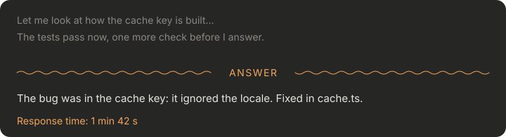

# Claude Code mods

Two small mods for [Claude Code](https://claude.com/claude-code): one keeps your session's prompt cache warm while you are away, the other shows where Claude's answer starts. Both work in the desktop app and in the terminal, and speak 13 languages.

---

## cache-keeper · a tiny kitchen that keeps your cache warm


Claude Code caches your conversation so each new message does not pay to re-read it. The cache cools down after a while with no requests (cache-keeper assumes one hour). Come back after that, and your next message reads the whole context again at full price.

`/cache-warm on 6` keeps the cache warm for 6 hours. Whenever the session has been quiet for 50 minutes, the mod asks the model a tiny side question about the session. It never shows in the chat, and the cache stays warm.

**Why is there a chef?** The cache is the soup, and the chef keeps it simmering.

- **One guest arrives for every hour** you asked for, and they queue at the right.
- **Each warm-up, the chef carries a bowl** across to the queue, and the next guest sits down to eat.
- **If an hour passes with no warm-up**, the last guest gives up and leaves. No warm-up means you were busy and the cache was warm anyway.
- **When you send a message**, the chef tastes the soup himself.

So a hungry queue means you worked through the hours, and a full table means the session sat idle while the mod kept it warm.

There is also a **guard**. The first message into a large session whose cache has gone cold is held back once, with a warning. Press Enter again to send it.

| Command | What it does |
| --- | --- |
| `/cache-warm on [hours]` | Keep the cache warm (8 hours by default, 24 at most) |
| `/cache-warm off` | Stop |
| `/cache-warm` | Status: time left, last warm-up, guests fed |
| `/cache-warm show band\|status\|both` | Kitchen above the prompt, a plain status line under it, or both |
| `/cache-warm demo [guests]` | A one-minute pretend shift, to see the kitchen at work |

**What it costs.** Each warm-up is one small request that reads your cached context. Cache reads cost about a tenth of normal input, and they count toward your plan's limits. That is worth it when you come back to a long session; turn it off when you are done.

---

## answer-divider · see where the answer starts



Claude often thinks out loud between tool calls, and in a long turn the final answer gets lost among it. answer-divider:

- **draws a thin line with "ANSWER"** above the final answer of each turn;
- **dims the interim text** between tool calls;
- **shows how long the turn took** under the answer.

`/answer-line` switches between a wave and a row of small triangles. Only the drawing changes: nothing the model reads.

---

## Install

In a terminal session of Claude Code:

```
/plugin install cache-keeper --marketplace oleksiydemidenko/claude-code-mods
/plugin install answer-divider --marketplace oleksiydemidenko/claude-code-mods
```

In the desktop app: click **+** next to the prompt box, then **Plugins**, **Add marketplace**, enter `oleksiydemidenko/claude-code-mods`, and add the plugins.

## Languages

English, Ukrainian, Russian, Belarusian, Polish, German, French, Spanish, Italian, Portuguese, Japanese, Chinese and Korean. By default each mod speaks the language you write in. To fix one, set the mod's `language` option in `/config`.

The kitchen's title is each language's own word for something on the stove: *Cooking*, *Mijote*, *Köchelt*, *Sobbolle*, *コトコト中*, *보글보글*…

## Notes

- Colors follow the app: orange on a dark theme, soft gray on a light one.
- Built on Claude Code's plugin API, which is still in early access. A Claude Code update may need a mod update; issues and pull requests are welcome.
- This is a personal project, not affiliated with or endorsed by Anthropic.

MIT license.
